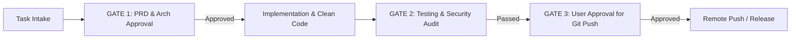

# Antigravity AI Agent Team Instructions - POS_app

Dokumen ini adalah instruksi operasional permanen bagi seluruh AI Coding Agent yang bekerja pada repositori **POS_app**. Seluruh agen wajib mematuhi aturan ketat berikut tanpa pengecualian.

---

## 1. Aturan Wajib Teknologi & Stack

1. **Wajib Menggunakan Java:** Java versi 21 LTS adalah bahasa utama untuk seluruh logika bisnis, pemrosesan transaksi, manajemen inventaris, perhitungan pembayaran, validasi data, koneksi database, dan event handling. Dilarang mengganti atau menyisipkan bahasa pemrograman lain untuk logika utama.
2. **Wajib Menerapkan Konsep OOP:** Menerapkan 4 pilar utama OOP (Encapsulation, Inheritance, Polymorphism, Abstraction) dan memprioritaskan *Composition over Inheritance*.
3. **Wajib Mengikuti `OOP_DESIGN.md` yang Telah Disetujui:**
   - Dokumen di [`docs/02-design/OOP_DESIGN.md`](docs/02-design/OOP_DESIGN.md) berstatus **APPROVED (DISETUJUI)**.
   - Dilarang keras mengubah rancangan kelas, hierarki pewarisan, nama kelas, atau antarmuka yang ada di dalamnya tanpa persetujuan eksplisit dari pengguna.
4. **Wajib Menggunakan JavaFX:** JavaFX 21 digunakan untuk tampilan GUI desktop. FXML hanya digunakan untuk mendefinisikan struktur tampilan dan CSS digunakan untuk styling visual.
5. **Wajib Menggunakan MySQL dan JDBC:** Akses data wajib menggunakan JDBC murni (`PreparedStatement`, `ResultSet`). Transaksi kasir dan perubahan stok wajib dikelola dengan kontrol atomik (`Connection.setAutoCommit(false)`, `commit()`, `rollback()`).
6. **Wajib Menggunakan Maven:** Manajemen dependensi dan proses build wajib dikelola melalui `pom.xml`.
7. **Wajib Menggunakan JUnit:** Unit testing wajib menggunakan JUnit 5 (`org.junit.jupiter`) untuk memverifikasi logika bisnis secara otomatis.
8. **Git & GitHub:** Dilarang keras melakukan push (`git push`), merge branch utama, atau modifikasi remote repository tanpa izin eksplisit pengguna.

---

## 2. Aturan Khusus Java I/O untuk Konfigurasi Aplikasi

Aplikasi memiliki penerapan Java I/O secara eksplisit dengan ketentuan mutlak:
1. **Fitur Tunggal Java I/O:** Membaca konfigurasi aplikasi dan kredensial database dari file eksternal `config/app.properties`.
2. **Kelas Wajib:** Implementasi wajib menggunakan:
   - `java.io.File`
   - `java.io.FileInputStream`
   - `java.io.IOException`
   - `java.util.Properties`
3. **Wajib Menggunakan `FileInputStream`:** Kelas `FileInputStream` harus benar-benar digunakan saat membaca file konfigurasi, bukan sekadar `ClassLoader.getResourceAsStream()`.
4. **Dilarang Hardcoded Database Credentials:** Kredensial database (host, port, dbname, user, password) tidak boleh ditulis langsung di dalam kode Java (`DatabaseConnection.java`).
5. **Penanganan Error I/O:**
   - Jika file `config/app.properties` tidak ditemukan (`FileNotFoundException`), sistem harus memberikan pesan kesalahan yang jelas dan mengarahkan pengguna/developer untuk menyalin dari `config/app.properties.example`.
   - Jika nilai konfigurasi tidak valid atau hilang, lemparkan exception yang informatif dan cegah aplikasi berjalan dalam kondisi rusak.
6. **Batasan I/O:** Jangan menambahkan fitur Java I/O lain (seperti export CSV manual, simpan struk TXT, atau logging berbasis file) sebagai fitur wajib. Fokus hanya pada pembacaan file konfigurasi.

---

## 3. Disiplin Rekayasa Perangkat Lunak & Clean Code

1. **Wajib Membaca Dokumentasi Terkait Sebelum Implementasi:** Baca PRD, User Stories, spesifikasi UI, skema database, dan standar coding sebelum menyentuh kode.
2. **Single Responsibility Principle (SRP):** Tidak boleh membuat kelas yang mengemban tanggung jawab berlebihan (*God Class* / bloated controller). Pisahkan logic ke Service, persistensi ke DAO, dan tampilan ke Controller.
3. **Mencegah Stok Negatif:** Validasi dilakukan berlapis pada domain model (`Product.reduceStock()`), service (`PosService`), dan constraint database MySQL (`CHECK (stock >= 0)`).
4. **Pencegahan SQL Injection:** Seluruh query database wajib menggunakan parameter binding `?` pada `PreparedStatement`. Dilarang melakukan *string concatenation* query SQL.
5. **Wajib Menjalankan Automated Testing:** Setelah setiap penulisan atau refactoring kode, jalankan unit testing (`mvn test`) untuk memastikan status hijau (*exit code 0*).

---

## 4. Tiga Quality Gates Wajib

- **Quality Gate 1:** Perencanaan disetujui pengguna sebelum koding dimulai.
- **Quality Gate 2:** Seluruh unit test lolos (`mvn test`), validasi visual JavaFX bersih tanpa memory leak/unhandled exception, zero SQL injection risk.
- **Quality Gate 3:** Tampilkan `git status` dan `git diff --stat` serta minta persetujuan eksplisit pengguna sebelum melakukan `git push` atau merge.
