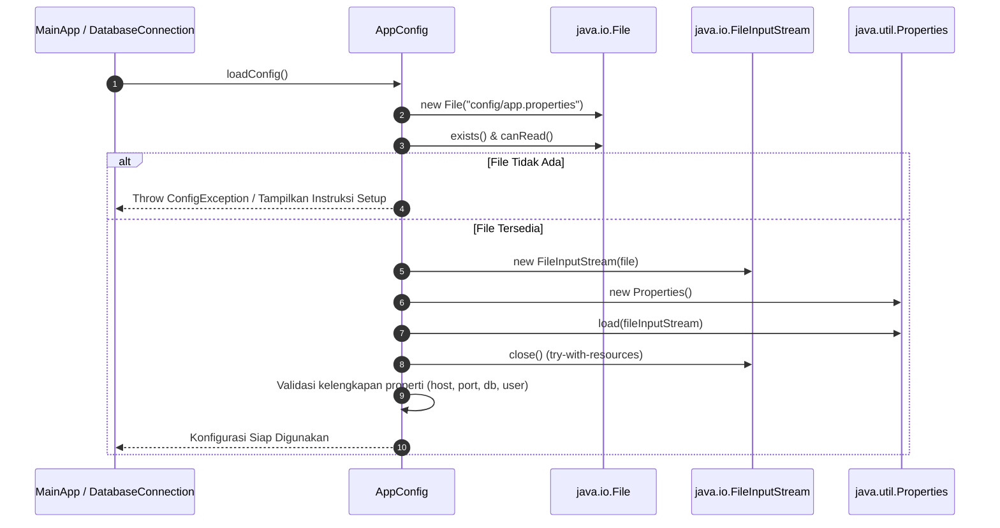

# System Architecture & Technical Design - POS_app

Dokumen ini menjelaskan arsitektur tingkat sistem, pemisahan lapisan (*layered architecture*), aliran data, integrasi Java I/O untuk konfigurasi aplikasi, serta manajemen transaksi database atomik pada **POS_app**.

---

## 1. Pola Arsitektur Berlapis (Layered Architecture)

POS_app menerapkan arsitektur berlapis yang memisahkan tanggung jawab kode secara tegas (*Separation of Concerns*):

```mermaid
flowchart TD
    subgraph Config_IO["Java I/O Configuration Layer"]
        FILE_CFG["config/app.properties\n(Local Filesystem)"]
        APP_CFG["AppConfig / ConfigLoader\n(File, FileInputStream, Properties)"]
        FILE_CFG -->|FileInputStream| APP_CFG
    end

    subgraph Presentation_Layer["Presentation Layer (JavaFX)"]
        UI_FXML["FXML Views & CSS Styles"]
        CTRL["JavaFX Controllers\n(Login, Dashboard, Pos, Product, Inventory, History, Report)"]
    end

    subgraph Service_Layer["Business Logic & Service Layer"]
        SVC["Services\n(AuthService, DashboardService, PosService, ProductService, InventoryService, ReportService)"]
    end

    subgraph Domain_Layer["Domain / Model Layer"]
        MDL["Entities & Value Objects\n(Product, Transaction, TransactionItem, User, Payment, etc.)"]
    end

    subgraph Data_Access_Layer["Data Access Layer (JDBC)"]
        DAO_INT["DAO Interfaces\n(ProductDao, TransactionDao, UserDao, InventoryDao)"]
        DAO_IMP["JDBC Implementations\n(ProductDaoJdbc, TransactionDaoJdbc, UserDaoJdbc, InventoryDaoJdbc)"]
        DBCONN["DatabaseConnection\n(Connection Manager)"]
    end

    subgraph Database["Database Infrastructure"]
        DB[(MySQL 8.x Database\npos_app_db)]
    end

    APP_CFG -->|Provides DB Credentials| DBCONN
    UI_FXML --> CTRL
    CTRL --> SVC
    SVC --> MDL
    SVC --> DAO_INT
    DAO_IMP ..|> DAO_INT
    DAO_IMP --> DBCONN
    DBCONN --> DB
    CTRL --> MDL
```

---

## 2. Penerapan Arsitektur Java I/O (Configuration Management)

Untuk memenuhi ketentuan khusus Java I/O dan mencegah *hardcoded credentials*, aplikasi menggunakan kelas utilitas `AppConfig` yang bertugas membaca file konfigurasi `config/app.properties`.

### 2.1 Alur Kerja Pembacaan Konfigurasi (Sequence)



### 2.2 Desain Kode Java I/O (`AppConfig.java`)
```java
package com.posapp.util;

import java.io.File;
import java.io.FileInputStream;
import java.io.FileNotFoundException;
import java.io.IOException;
import java.util.Properties;

public class AppConfig {
    private static final String CONFIG_FILE_PATH = "config/app.properties";
    private static final Properties properties = new Properties();
    private static boolean loaded = false;

    public static synchronized void load() {
        if (loaded) return;

        File configFile = new File(CONFIG_FILE_PATH);
        if (!configFile.exists()) {
            throw new RuntimeException(
                "File konfigurasi '" + CONFIG_FILE_PATH + "' tidak ditemukan!\n" +
                "Silakan salin 'config/app.properties.example' menjadi '" + CONFIG_FILE_PATH + "' " +
                "dan sesuaikan kredensial MySQL Anda."
            );
        }

        // Penggunaan eksplisit FileInputStream dengan try-with-resources
        try (FileInputStream fis = new FileInputStream(configFile)) {
            properties.load(fis);
            validateRequiredProperties();
            loaded = true;
        } catch (FileNotFoundException e) {
            throw new RuntimeException("Gagal membuka file konfigurasi: " + e.getMessage(), e);
        } catch (IOException e) {
            throw new RuntimeException("Kesalahan I/O saat membaca file konfigurasi: " + e.getMessage(), e);
        }
    }

    private static void validateRequiredProperties() {
        String[] requiredKeys = {"db.host", "db.port", "db.name", "db.user"};
        for (String key : requiredKeys) {
            if (properties.getProperty(key) == null || properties.getProperty(key).trim().isEmpty()) {
                throw new IllegalStateException("Konfigurasi wajib hilang atau kosong: " + key);
            }
        }
    }

    public static String get(String key) {
        if (!loaded) load();
        return properties.getProperty(key);
    }

    public static String get(String key, String defaultValue) {
        if (!loaded) load();
        return properties.getProperty(key, defaultValue);
    }
}
```

---

## 3. Manajemen Koneksi Database (`DatabaseConnection.java`)

`DatabaseConnection` memanfaatkan data yang dibaca oleh `AppConfig` untuk menyusun JDBC URL dinamis:

```java
package com.posapp.util;

import java.sql.Connection;
import java.sql.DriverManager;
import java.sql.SQLException;

public class DatabaseConnection {
    private static Connection connection;

    private DatabaseConnection() {}

    public static synchronized Connection getConnection() {
        try {
            if (connection == null || connection.isClosed()) {
                AppConfig.load(); // Membaca file konfigurasi via Java I/O

                String host = AppConfig.get("db.host");
                String port = AppConfig.get("db.port");
                String dbName = AppConfig.get("db.name");
                String user = AppConfig.get("db.user");
                String password = AppConfig.get("db.password", "");
                String useSSL = AppConfig.get("db.useSSL", "false");
                String timezone = AppConfig.get("db.serverTimezone", "Asia/Jakarta");

                String jdbcUrl = String.format(
                    "jdbc:mysql://%s:%s/%s?useSSL=%s&serverTimezone=%s&allowPublicKeyRetrieval=true",
                    host, port, dbName, useSSL, timezone
                );

                connection = DriverManager.getConnection(jdbcUrl, user, password);
            }
            return connection;
        } catch (SQLException e) {
            throw new RuntimeException("Koneksi database MySQL gagal: " + e.getMessage(), e);
        }
    }
}
```

---

## 4. Alur Transaksi Atomik (Checkout & Pembatalan Transaksi)

### 4.1 Transaksi Checkout Penjualan Kasir
1. Validasi saldo stok fisik di memori dan query row-locking database.
2. `conn.setAutoCommit(false);`
3. Simpan header `transactions`.
4. Simpan batch detail `transaction_details` lengkap dengan snapshot `unit_price` dan `buy_price_snapshot`.
5. Potong stok produk: `UPDATE products SET stock = stock - ? WHERE id = ?`.
6. Catat audit mutasi: `INSERT INTO stock_movements (...) VALUES (?, ?, 'SALE', ...)`.
7. `conn.commit();`
8. Jika terjadi error di salah satu langkah: `conn.rollback();`.

### 4.2 Transaksi Pembatalan Nota oleh Admin (Cancellation with Stock Restoration)
1. Verifikasi peran pengguna yang melakukan aksi wajib `ADMIN`.
2. Verifikasi status transaksi belum pernah dibatalkan (`status = 'COMPLETED'`).
3. `conn.setAutoCommit(false);`
4. Update header: `UPDATE transactions SET status = 'CANCELLED', cancelled_by = ?, cancelled_at = NOW(), cancellation_reason = ? WHERE id = ?`.
5. Ambil seluruh item dari `transaction_details` yang bersangkutan.
6. Kembalikan stok produk: `UPDATE products SET stock = stock + ? WHERE id = ?`.
7. Catat audit mutasi pengembalian: `INSERT INTO stock_movements (...) VALUES (?, ?, 'CANCELLATION_RETURN', ...)`.
8. `conn.commit();`
9. Jika terjadi kendala: `conn.rollback();`.
