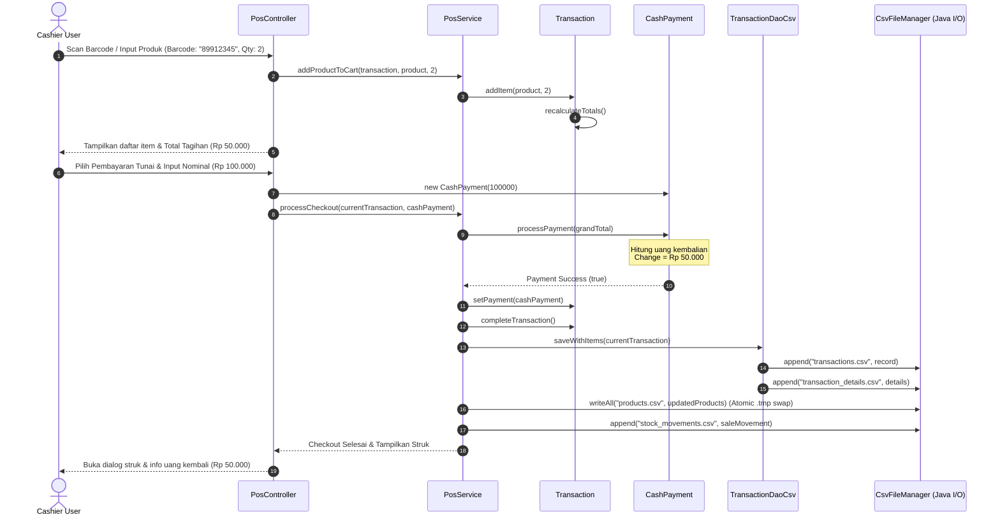

# Desain Object-Oriented Programming (OOP) - Aplikasi POS_app

Dokumen ini merupakan panduan arsitektur dan spesifikasi rancangan berorientasi objek (*Object-Oriented Programming*) untuk aplikasi **POS_app** (*Point of Sale Application*). Seluruh rancangan disusun secara realistis dan proporsional untuk tingkat proyek mahasiswa rekayasa perangkat lunak dengan stack teknologi: **Java 21**, **JavaFX 21**, **Maven**, dan **Java I/O (Penyimpanan Berkas CSV)**.

---

## 1. Arsitektur Umum & Struktur Modul

Aplikasi POS_app menerapkan pola arsitektur berlapis (*Layered Architecture*) yang memisahkan tanggung jawab kode menjadi 4 lapisan utama:
1. **Presentation Layer (`com.posapp.controller` & FXML/CSS):** Menangani interaksi UI JavaFX, event handling, dan pembaruan visual.
2. **Business Logic Layer (`com.posapp.service`):** Memproses aturan bisnis, kalkulasi pembayaran, validasi data, dan orkestrasi mutasi data.
3. **Domain / Model Layer (`com.posapp.model`):** Merepresentasikan entitas bisnis, aturan data internal, dan hubungan asosiasi/komposisi.
4. **Data Access Layer (`com.posapp.dao`):** Mengelola persistensi data berkas CSV lokal melalui Java I/O (`File`, `FileReader`, `BufferedReader`, `FileWriter`, `BufferedWriter`, dan `CsvFileManager`).

```
com.posapp
├── app/                  # Main Application Entry Point (JavaFX)
├── model/                # Entity & Value Objects (Encapsulation & Domain Rules)
│   └── enums/            # Role, MovementType, TransactionStatus, PaymentType
├── dao/                  # Data Access Object Interfaces (Abstraction)
│   └── csv/              # Concrete CSV File Implementation (Java I/O Data Operations)
├── service/              # Core Business Logic & Coordination
├── controller/           # JavaFX UI Controllers (Event Handling & View Glue)
└── util/                 # CsvFileManager, CsvParser, CsvFormatter, AppConfig, PasswordSecurity
```

---

## 2. Diagram Kelas UML (Mermaid Class Diagram)

Berikut adalah diagram kelas inti yang memetakan hubungan antar-kelas domain, kontrak antarmuka (*interface*), dan pewarisan (*inheritance*) dalam aplikasi POS_app.

```mermaid
classDiagram
    %% Model Layer
    class User {
        <<abstract>>
        -int id
        -String username
        -String passwordHash
        -String fullName
        -Role role
        -boolean active
        +User(int id, String username, String passwordHash, String fullName, Role role)
        +getId() int
        +getUsername() String
        +getFullName() String
        +getRole() Role
        +isActive() boolean
        +canAccessAdminMenu()* boolean
    }

    class Admin {
        +Admin(int id, String username, String passwordHash, String fullName)
        +canAccessAdminMenu() boolean
    }

    class Cashier {
        -String terminalId
        +Cashier(int id, String username, String passwordHash, String fullName, String terminalId)
        +getTerminalId() String
        +canAccessAdminMenu() boolean
    }

    User <|-- Admin
    User <|-- Cashier

    class Category {
        -int id
        -String name
        -String description
        +Category(int id, String name, String description)
        +getId() int
        +getName() String
        +getDescription() String
    }

    class Product {
        -int id
        -String barcode
        -String name
        -Category category
        -double buyPrice
        -double sellPrice
        -int stock
        -int minStockAlert
        +Product(int id, String barcode, String name, Category category, double buyPrice, double sellPrice, int stock, int minStockAlert)
        +calculateProfitMargin() double
        +reduceStock(int quantity) void
        +addStock(int quantity) void
        +isLowStock() boolean
        +getBarcode() String
        +getName() String
        +getSellPrice() double
        +getStock() int
        +getCategory() Category
    }

    Product --> Category : belongs to

    class Payment {
        <<abstract>>
        -int id
        -double amountPaid
        -LocalDateTime paymentTime
        -PaymentType paymentType
        +Payment(int id, double amountPaid, PaymentType paymentType)
        +getAmountPaid() double
        +getPaymentType() PaymentType
        +getPaymentTime() LocalDateTime
        +processPayment(double grandTotal)* boolean
        +getPaymentSummary()* String
    }

    class CashPayment {
        -double change
        +CashPayment(double amountPaid)
        +processPayment(double grandTotal) boolean
        +getPaymentSummary() String
        +getChange() double
    }

    class QrisPayment {
        -String transactionReference
        -String qrContent
        -boolean settled
        +QrisPayment(double amountPaid, String transactionReference, String qrContent)
        +processPayment(double grandTotal) boolean
        +getPaymentSummary() String
        +getTransactionReference() String
    }

    Payment <|-- CashPayment
    Payment <|-- QrisPayment

    class TransactionItem {
        -int id
        -Product product
        -int quantity
        -double unitPrice
        -double subtotalDiscount
        -double lineTotal
        +TransactionItem(Product product, int quantity, double unitPrice, double subtotalDiscount)
        +calculateLineTotal() double
        +getProduct() Product
        +getQuantity() int
        +getUnitPrice() double
        +getLineTotal() double
    }

    TransactionItem --> Product : references

    class Transaction {
        -int id
        -String invoiceNumber
        -User cashier
        -LocalDateTime transactionDate
        -List~TransactionItem~ items
        -Payment payment
        -double subtotal
        -double taxAmount
        -double discountAmount
        -double grandTotal
        -TransactionStatus status
        +Transaction(String invoiceNumber, User cashier)
        +addItem(Product product, int quantity) void
        +removeItem(Product product) void
        +recalculateTotals() void
        +setPayment(Payment payment) void
        +completeTransaction() void
        +getInvoiceNumber() String
        +getItems() List~TransactionItem~
        +getGrandTotal() double
        +getPayment() Payment
        +getStatus() TransactionStatus
    }

    Transaction "1" *-- "many" TransactionItem : composition
    Transaction --> User : handled by
    Transaction --> Payment : settled with

    class StockMovement {
        -int id
        -Product product
        -User user
        -MovementType movementType
        -int quantity
        -int stockBefore
        -int stockAfter
        -LocalDateTime timestamp
        -String remarks
        +StockMovement(Product product, User user, MovementType type, int qty, int before, int after, String remarks)
        +getProduct() Product
        +getMovementType() MovementType
        +getQuantity() int
        +getRemarks() String
    }

    StockMovement --> Product : affects
    StockMovement --> User : logged by

    %% DAO Layer (Abstraction)
    class ProductDao {
        <<interface>>
        +findById(int id) Product
        +findByBarcode(String barcode) Product
        +findAll() List~Product~
        +insert(Product product) boolean
        +update(Product product) boolean
        +updateStock(int productId, int newStock) boolean
        +delete(int id) boolean
    }

    class TransactionDao {
        <<interface>>
        +saveWithItems(Transaction transaction) boolean
        +findById(int id) Transaction
        +findByInvoiceNumber(String invoiceNo) Transaction
        +findByDateRange(LocalDate from, LocalDate to) List~Transaction~
        +updateStatus(int id, Transaction transaction) boolean
    }

    class UserDao {
        <<interface>>
        +findByUsername(String username) User
        +findById(int id) User
        +findAll() List~User~
        +insert(User user) boolean
        +update(User user) boolean
        +delete(int id) boolean
    }

    class ProductDaoCsv {
        -CsvFileManager fileManager
        -CategoryDao categoryDao
        +ProductDaoCsv(CsvFileManager fileManager, CategoryDao categoryDao)
        +findById(int id) Product
        +findByBarcode(String barcode) Product
        +findAll() List~Product~
        +insert(Product product) boolean
        +update(Product product) boolean
        +updateStock(int productId, int newStock) boolean
        +delete(int id) boolean
    }

    ProductDao <|.. ProductDaoCsv : implements
```



---

## 3. Daftar Kelas dan Tanggung Jawab (Single Responsibility Principle)

### 3.1 Domain Models (`com.posapp.model`)

| Kelas | Tipe | Tanggung Jawab Utama |
| :--- | :--- | :--- |
| `User` | Abstract Class | Menyimpan atribut dasar pengguna (kredensial, nama lengkap, role), serta mendefinisikan kontrak akses menu hak istimewa melalui method abstrak `canAccessAdminMenu()`. |
| `Admin` | Concrete Class | Mewarisi `User`, mengizinkan akses ke seluruh modul manajerial (laporan, manajemen user, restock, harga produk). |
| `Cashier` | Concrete Class | Mewarisi `User`, membatasi akses hanya pada operasional kasir (POS), cetak struk, dan riwayat shift aktif. |
| `Category` | Concrete Class | Menyimpan pengelompokan produk (makanan, minuman, sembako, dsb.). |
| `Product` | Concrete Class | Menyimpan data produk, harga beli, harga jual, stok saat ini, batas minimum stok, serta logika mutasi stok dan pengecekan stok kritis. |
| `Transaction` | Concrete Class | Mengelola siklus transaksi penjualan: keranjang belanja (`List<TransactionItem>`), subtotal, pajak, diskon, grand total, asosiasi dengan kasir yang bertugas, dan status pembayaran. |
| `TransactionItem` | Concrete Class | Menyimpan rincian tiap item dalam keranjang (produk, jumlah beli, harga satuan yang berlaku saat transaksi, dan subtotal harga). |
| `Payment` | Abstract Class | Merepresentasikan proses pelunasan transaksi secara abstrak dan menyediakan method abstrak `processPayment(double grandTotal)`. |
| `CashPayment` | Concrete Class | Mewarisi `Payment`, memvalidasi kecukupan uang tunai yang diterima dan menghitung uang kembalian (*change*). |
| `QrisPayment` | Concrete Class | Mewarisi `Payment`, mengelola kode referensi QRIS transaksi digital dan memverifikasi status pembayaran. |
| `StockMovement` | Concrete Class | Mencatat riwayat mutasi stok (*audit trail*) baik karena penjualan, stok masuk (*restock*), penyesuaian manual (*opname*), maupun retur pembatalan. |

### 3.2 Data Access Layer (`com.posapp.dao.csv`)

| Kelas / Interface | Tipe | Tanggung Jawab Utama |
| :--- | :--- | :--- |
| `UserDao` | Interface | Kontrak operasi persistensi data pengguna. |
| `ProductDao` | Interface | Kontrak operasi persistensi produk, lookup barcode, dan pembaruan stok. |
| `TransactionDao` | Interface | Kontrak penyimpanan transaksi penjualan dan detail rincian belanja. |
| `InventoryDao` | Interface | Kontrak pencatatan mutasi stok dan kartu stok log barang. |
| `ProductDaoCsv` | Concrete Class | Implementasi Java I/O untuk file `data/products.csv` menggunakan `CsvFileManager`. |
| `TransactionDaoCsv`| Concrete Class | Implementasi Java I/O untuk file `data/transactions.csv` dan `data/transaction_details.csv`. |
| `UserDaoCsv` | Concrete Class | Implementasi Java I/O untuk file `data/users.csv`. |
| `InventoryDaoCsv` | Concrete Class | Implementasi Java I/O untuk file `data/stock_movements.csv`. |
| `CsvFileManager` | Concrete Class | Kelas utilitas Java I/O yang mengelola pembacaan (`BufferedReader`), penulisan atomik (`BufferedWriter`), dan penanganan berkas `.tmp`. |

### 3.3 Business Logic / Service Layer (`com.posapp.service`)

| Kelas | Tipe | Tanggung Jawab Utama |
| :--- | :--- | :--- |
| `AuthService` | Class | Memverifikasi kredensial login, mencocokkan hash password (menggunakan BCrypt), dan memelihara sesi pengguna aktif (`currentUser`). |
| `ProductService` | Class | Validasi input data produk (harga jual tidak boleh < harga beli, barcode harus unik) dan koordinasi dengan `ProductDao`. |
| `PosService` | Class | Orkestrasi transaksi penjualan: validasi ketersediaan stok produk sebelum masuk keranjang, kalkulasi diskon/pajak, eksekusi pembayaran polimorfik, pembaruan stok, dan pemanggilan `TransactionDao`. |
| `InventoryService` | Class | Menangani penerimaan stok barang masuk (*restock*), penyesuaian stok selisih opname, dan deteksi dini barang yang berada di bawah `minStockAlert`. |
| `TransactionService` | Class | Mengelola riwayat penjualan dan pembatalan transaksi oleh Admin yang secara otomatis mengembalikan stok barang (*stock restoration*). |
| `DashboardService` | Class | Mengagregasi metrik operasional toko harian dari file CSV. |
| `ReportService` | Class | Agregator data penjualan harian, bulanan, produk terlaris, dan valuasi aset persediaan dari berkas CSV. |

---

## 4. Hubungan Antar-Class (Class Relationships)

Dalam POS_app, hubungan antar-objek dirancang dengan cermat dan memprioritaskan prinsip **Composition over Inheritance**:

1. **Generalization (Inheritance):**
   - `Admin` dan `Cashier` mewarisi `User`.
   - `CashPayment` dan `QrisPayment` mewarisi `Payment`.
2. **Realization (Interface Implementation):**
   - `ProductDaoCsv` mengimplementasikan antarmuka `ProductDao`.
   - `TransactionDaoCsv` mengimplementasikan antarmuka `TransactionDao`.
   - `UserDaoCsv` mengimplementasikan antarmuka `UserDao`.
3. **Composition (Hubungan Kepemilikan Kuat / "Part-of"):**
   - `Transaction` memiliki relasi **Komposisi** terhadap `TransactionItem`. Objek `TransactionItem` tidak memiliki arti dan tidak boleh eksis tanpa adanya objek induk `Transaction`.
4. **Aggregation / Association (Hubungan Menggunakan / "Has-a"):**
   - `Transaction` berasosiasi dengan `User` (kasir yang memproses nota).
   - `Transaction` berasosiasi dengan `Payment` (metode bayar yang digunakan).
   - `TransactionItem` mengacu pada `Product`.
5. **Dependency (Hubungan Ketergantungan / "Uses-a"):**
   - `PosController` bergantung pada `PosService`.
   - `PosService` bergantung pada `ProductDao` dan `TransactionDao`.
   - `ProductDaoCsv` bergantung pada `CsvFileManager`.

---

## 5. Penerapan Empat Pilar Utama OOP

### 5.1 Encapsulation (Enkapsulasi)
Seluruh field domain berstatus `private` dengan validasi data internal pada domain method:
- `Product.reduceStock(quantity)` melempar `IllegalStateException` jika kuantitas melebihi sisa stok, mencegah stok bernilai negatif.
- Constructor `Product` memvalidasi harga jual $\ge$ harga beli.

### 5.2 Inheritance (Pewarisan)
Pewarisan diterapkan secara fungsional:
- Kelas `User` (abstrak) diwarisi oleh `Admin` dan `Cashier` untuk membedakan wewenang akses menu.
- Kelas `Payment` (abstrak) diwarisi oleh `CashPayment` (kalkulasi uang kembalian) dan `QrisPayment` (verifikasi nomor referensi digital).

### 5.3 Polymorphism (Polimorfisme)
- **Dynamic Polymorphism:** Pada saat checkout kasir, `PosService` cukup memanggil `payment.processPayment(grandTotal)` dan `payment.getPaymentSummary()`. Java mengeksekusi perilaku yang tepat pada saat runtime tanpa branching `instanceof`.

### 5.4 Abstraction (Abstraksi)
- Seluruh Service Layer hanya bergantung pada antarmuka abstrak (`ProductDao`, `TransactionDao`, `UserDao`).
- Detail bagaimana data dibaca dan ditulis menggunakan `BufferedReader` dan `BufferedWriter` terisolasi sepenuhnya di dalam kelas implementasi `ProductDaoCsv` dan `CsvFileManager`.

---

## 6. Contoh Alur Penggunaan Object dalam Transaksi Kasir


