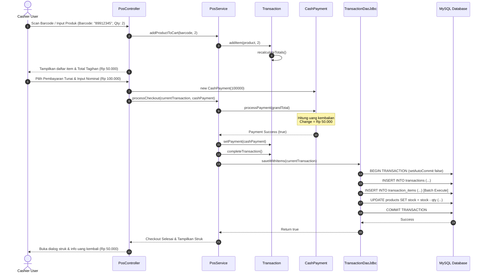

# Desain Object-Oriented Programming (OOP) - Aplikasi POS_app

Dokumen ini merupakan panduan arsitektur dan spesifikasi rancangan berorientasi objek (*Object-Oriented Programming*) untuk aplikasi **POS_app** (*Point of Sale Application*). Seluruh rancangan disusun secara realistis dan proporsional untuk tingkat proyek mahasiswa rekayasa perangkat lunak dengan stack teknologi: **Java**, **JavaFX**, **Maven**, **MySQL**, dan **JDBC**.

---

## 1. Arsitektur Umum & Struktur Modul

Aplikasi POS_app menerapkan pola arsitektur berlapis (*Layered Architecture*) yang memisahkan tanggung jawab kode menjadi 4 lapisan utama:
1. **Presentation Layer (`com.posapp.controller` & FXML/CSS):** Menangani interaksi UI JavaFX, event handling, dan pembaruan visual.
2. **Business Logic Layer (`com.posapp.service`):** Memproses aturan bisnis, kalkulasi pembayaran, validasi data, dan manajemen transaksi database.
3. **Domain / Model Layer (`com.posapp.model`):** Merepresentasikan entitas bisnis, aturan data internal, dan hubungan asosiasi/komposisi.
4. **Data Access Layer (`com.posapp.dao`):** Mengelola koneksi database MySQL melalui JDBC murni (*PreparedStatements*, *ResultSet*, dan *Transaction Commit/Rollback*).

```
com.posapp
├── app/                  # Main Application Entry Point (JavaFX)
├── model/                # Entity & Value Objects (Encapsulation & Domain Rules)
│   └── enums/            # Role, MovementType, TransactionStatus, PaymentType
├── dao/                  # Data Access Object Interfaces (Abstraction)
│   └── jdbc/             # Concrete JDBC Implementation (Database Operations)
├── service/              # Core Business Logic & Coordination
│   └── report/           # Report Generators (Polymorphism & Abstraction)
├── controller/           # JavaFX UI Controllers (Event Handling & View Glue)
└── util/                 # DatabaseConnection, PasswordSecurity, CurrencyFormatter
```

---

## 2. Diagram Kelas UML (Mermaid Class Diagram)

Berikut adalah diagram kelas inti yang memetakan hubungan antar-kelas domain, kontrak antarmuka (*interface*), dan pewarisan (*inheritance*) dalam aplikasi POS_app.

```mermaid
classDiagram
    %% Model Layer
    class User {
        <<abstract>>
        -int id
        -String username
        -String passwordHash
        -String fullName
        -Role role
        -boolean active
        +User(int id, String username, String passwordHash, String fullName, Role role)
        +getId() int
        +getUsername() String
        +getFullName() String
        +getRole() Role
        +isActive() boolean
        +canAccessAdminMenu()* boolean
    }

    class Admin {
        +Admin(int id, String username, String passwordHash, String fullName)
        +canAccessAdminMenu() boolean
    }

    class Cashier {
        -String terminalId
        +Cashier(int id, String username, String passwordHash, String fullName, String terminalId)
        +getTerminalId() String
        +canAccessAdminMenu() boolean
    }

    User <|-- Admin
    User <|-- Cashier

    class Category {
        -int id
        -String name
        -String description
        +Category(int id, String name, String description)
        +getId() int
        +getName() String
        +getDescription() String
    }

    class Product {
        -int id
        -String barcode
        -String name
        -Category category
        -double buyPrice
        -double sellPrice
        -int stock
        -int minStockAlert
        +Product(int id, String barcode, String name, Category category, double buyPrice, double sellPrice, int stock, int minStockAlert)
        +calculateProfitMargin() double
        +reduceStock(int quantity) void
        +addStock(int quantity) void
        +isLowStock() boolean
        +getBarcode() String
        +getName() String
        +getSellPrice() double
        +getStock() int
        +getCategory() Category
    }

    Product --> Category : belongs to

    class Payment {
        <<abstract>>
        -int id
        -double amountPaid
        -LocalDateTime paymentTime
        -PaymentType paymentType
        +Payment(int id, double amountPaid, PaymentType paymentType)
        +getAmountPaid() double
        +getPaymentType() PaymentType
        +getPaymentTime() LocalDateTime
        +processPayment(double grandTotal)* boolean
        +getPaymentSummary()* String
    }

    class CashPayment {
        -double change
        +CashPayment(double amountPaid)
        +processPayment(double grandTotal) boolean
        +getPaymentSummary() String
        +getChange() double
    }

    class QrisPayment {
        -String transactionReference
        -String qrContent
        -boolean settled
        +QrisPayment(double amountPaid, String transactionReference, String qrContent)
        +processPayment(double grandTotal) boolean
        +getPaymentSummary() String
        +getTransactionReference() String
    }

    Payment <|-- CashPayment
    Payment <|-- QrisPayment

    class TransactionItem {
        -int id
        -Product product
        -int quantity
        -double unitPrice
        -double subtotalDiscount
        -double lineTotal
        +TransactionItem(Product product, int quantity, double unitPrice, double subtotalDiscount)
        +calculateLineTotal() double
        +getProduct() Product
        +getQuantity() int
        +getUnitPrice() double
        +getLineTotal() double
    }

    TransactionItem --> Product : references

    class Transaction {
        -int id
        -String invoiceNumber
        -User cashier
        -LocalDateTime transactionDate
        -List~TransactionItem~ items
        -Payment payment
        -double subtotal
        -double taxAmount
        -double discountAmount
        -double grandTotal
        -TransactionStatus status
        +Transaction(String invoiceNumber, User cashier)
        +addItem(Product product, int quantity) void
        +removeItem(Product product) void
        +recalculateTotals() void
        +setPayment(Payment payment) void
        +completeTransaction() void
        +getInvoiceNumber() String
        +getItems() List~TransactionItem~
        +getGrandTotal() double
        +getPayment() Payment
        +getStatus() TransactionStatus
    }

    Transaction "1" *-- "many" TransactionItem : composition
    Transaction --> User : handled by
    Transaction --> Payment : settled with

    class StockMovement {
        -int id
        -Product product
        -User user
        -MovementType movementType
        -int quantity
        -int stockBefore
        -int stockAfter
        -LocalDateTime timestamp
        -String remarks
        +StockMovement(Product product, User user, MovementType type, int qty, int before, int after, String remarks)
        +getProduct() Product
        +getMovementType() MovementType
        +getQuantity() int
        +getRemarks() String
    }

    StockMovement --> Product : affects
    StockMovement --> User : logged by

    %% DAO Layer (Abstraction)
    class ProductDao {
        <<interface>>
        +findById(int id) Product
        +findByBarcode(String barcode) Product
        +findAll() List~Product~
        +insert(Product product) boolean
        +update(Product product) boolean
        +updateStock(int productId, int newStock) boolean
        +delete(int id) boolean
    }

    class TransactionDao {
        <<interface>>
        +saveWithItems(Transaction transaction) boolean
        +findById(int id) Transaction
        +findByInvoiceNumber(String invoiceNo) Transaction
        +findByDateRange(LocalDate from, LocalDate to) List~Transaction~
    }

    class UserDao {
        <<interface>>
        +findByUsername(String username) User
        +findById(int id) User
        +findAll() List~User~
        +insert(User user) boolean
        +update(User user) boolean
    }

    class ProductDaoJdbc {
        -Connection connection
        +ProductDaoJdbc(Connection connection)
        +findById(int id) Product
        +findByBarcode(String barcode) Product
        +findAll() List~Product~
        +insert(Product product) boolean
        +update(Product product) boolean
        +updateStock(int productId, int newStock) boolean
        +delete(int id) boolean
    }

    ProductDao <|.. ProductDaoJdbc : implements
```



---

## 3. Daftar Kelas dan Tanggung Jawab (Single Responsibility Principle)

### 3.1 Domain Models (`com.posapp.model`)

| Kelas | Tipe | Tanggung Jawab Utama |
| :--- | :--- | :--- |
| `User` | Abstract Class | Menyimpan atribut dasar pengguna (kredensial, nama lengkap, role), serta mendefinisikan kontrak akses menu hak istimewa melalui method abstrak `canAccessAdminMenu()`. |
| `Admin` | Concrete Class | Mewarisi `User`, mengizinkan akses ke seluruh modul manajerial (laporan, manajemen user, restock, harga produk). |
| `Cashier` | Concrete Class | Mewarisi `User`, membatasi akses hanya pada operasional kasir (POS), cetak struk, dan riwayat shift aktif. |
| `Category` | Concrete Class | Menyimpan pengelompokan produk (makanan, minuman, sembako, dsb.). |
| `Product` | Concrete Class | Menyimpan data produk, harga beli, harga jual, stok saat ini, batas minimum stok, serta logika mutasi stok dan pengecekan stok kritis. |
| `Transaction` | Concrete Class | Mengelola siklus transaksi penjualan: keranjang belanja (`List<TransactionItem>`), subtotal, pajak, diskon, grand total, asosiasi dengan kasir yang bertugas, dan status pembayaran. |
| `TransactionItem` | Concrete Class | Menyimpan rincian tiap item dalam keranjang (produk, jumlah beli, harga satuan yang berlaku saat transaksi, dan subtotal harga). |
| `Payment` | Abstract Class | Merepresentasikan proses pelunasan transaksi secara abstrak dan menyediakan method abstrak `processPayment(double grandTotal)`. |
| `CashPayment` | Concrete Class | Mewarisi `Payment`, memvalidasi kecukupan uang tunai yang diterima dan menghitung uang kembalian (*change*). |
| `QrisPayment` | Concrete Class | Mewarisi `Payment`, mengelola kode referensi QRIS transaksi digital dan memverifikasi status pembayaran. |
| `StockMovement` | Concrete Class | Mencatat riwayat mutasi stok (*audit trail*) baik karena penjualan, stok masuk (*restock*), maupun penyesuaian manual (*opname*). |

### 3.2 Data Access Layer (`com.posapp.dao`)

| Kelas / Interface | Tipe | Tanggung Jawab Utama |
| :--- | :--- | :--- |
| `UserDao` | Interface | Kontrak operasi persistensi pengguna (autentikasi dan data user). |
| `ProductDao` | Interface | Kontrak operasi persistensi produk, lookup barcode, dan pembaruan stok. |
| `TransactionDao` | Interface | Kontrak penyimpanan transaksi penjualan secara atomik (*atomic transaction*) beserta item detailnya. |
| `InventoryDao` | Interface | Kontrak pencatatan mutasi stok dan kartu stok log barang. |
| `ProductDaoJdbc` | Concrete Class | Implementasi JDBC untuk query MySQL tabel `products` menggunakan `PreparedStatement` aman dari SQL Injection. |
| `TransactionDaoJdbc` | Concrete Class | Implementasi JDBC yang mengontrol `Connection.setAutoCommit(false)`, menyimpan header transaksi dan rincian item dalam 1 unit transaksi, lalu `commit()` atau `rollback()`. |
| `DatabaseConnection` | Singleton / Utility | Mengelola koneksi database MySQL melalui `DriverManager`, membaca konfigurasi URL, port, nama database, user, dan password. |

### 3.3 Business Logic / Service Layer (`com.posapp.service`)

| Kelas | Tipe | Tanggung Jawab Utama |
| :--- | :--- | :--- |
| `AuthService` | Class | Memverifikasi kredensial login, mencocokkan hash password (menggunakan algoritma hashing aman seperti SHA-256 / BCrypt), dan memelihara sesi pengguna aktif (`currentUser`). |
| `ProductService` | Class | Validasi input data produk (harga jual tidak boleh < harga beli, barcode harus unik), pagination, dan koordinasi dengan `ProductDao`. |
| `PosService` | Class | Orkestrasi transaksi penjualan: validasi ketersediaan stok produk sebelum masuk keranjang, kalkulasi diskon/pajak, eksekusi pembayaran polimorfik, pembaruan stok, dan pemanggilan `TransactionDao`. |
| `InventoryService` | Class | Menangani penerimaan stok barang masuk (*restock*), penyesuaian stok selisih opname, dan deteksi dini barang yang berada di bawah `minStockAlert`. |
| `ReportService` | Class | Agregator data penjualan harian, mingguan, dan bulanan yang menggunakan abstraksi `ReportGenerator`. |
| `ReportGenerator` | Interface | Kontrak perilaku untuk menghasilkan dan mengekspor dokumen laporan (misal: PDF/CSV). |
| `DailySalesReportGenerator` | Concrete Class | Mengimplementasikan `ReportGenerator` khusus untuk rekap omset dan keuntungan harian. |
| `StockStatusReportGenerator` | Concrete Class | Mengimplementasikan `ReportGenerator` untuk status persediaan dan stok kritis. |

### 3.4 Presentation Layer / JavaFX Controllers (`com.posapp.controller`)

| Kelas | Tipe | Tanggung Jawab Utama |
| :--- | :--- | :--- |
| `LoginController` | Class | Mengikat form login FXML, membaca input username/password, memanggil `AuthService`, dan mengarahkan navigasi berdasarkan peran pengguna (`Admin` vs `Cashier`). |
| `MainDashboardController` | Class | Menampilkan navigasi utama, status kasir/admin aktif, dan ringkasan metrik aplikasi. |
| `PosController` | Class | Mengatur tampilan kasir: scan barcode produk, tabel keranjang belanja, kalkulasi realtime pembayaran tunai/QRIS, dan tombol cetak nota. |
| `ProductController` | Class | Mengelola tabel data produk, filter kategori, dialog tambah/edit produk, dan validasi form input. |
| `InventoryController` | Class | Menangani tabel mutasi stok, form barang masuk (*restock*), dan tanda peringatan stok menipis. |
| `TransactionHistoryController`| Class | Menampilkan riwayat transaksi, pencarian nomor faktur, filter tanggal, dan melihat kembali struk transaksi lama. |
| `ReportController` | Class | Menangani pemilihan jenis laporan, periode tanggal, dan pemanggilan generator ekspor file. |

---

## 4. Hubungan Antar-Class (Class Relationships)

Dalam POS_app, hubungan antar-objek dirancang dengan cermat dan memprioritaskan prinsip **Composition over Inheritance**:

1. **Generalization (Inheritance):**
   - `Admin` dan `Cashier` mewarisi `User`. Keduanya memiliki kemiripan atribut dasar (id, username, password, fullName) namun berbeda dalam hak akses fitur.
   - `CashPayment` dan `QrisPayment` mewarisi `Payment`. Keduanya memiliki atribut umum pembayaran (waktu, tipe, jumlah yang dibayar), tetapi memiliki algoritma validasi dan data spesifik yang berbeda.

2. **Realization (Interface Implementation):**
   - `ProductDaoJdbc` mengimplementasikan antarmuka `ProductDao`.
   - `TransactionDaoJdbc` mengimplementasikan antarmuka `TransactionDao`.
   - `DailySalesReportGenerator` mengimplementasikan antarmuka `ReportGenerator`.

3. **Composition (Hubungan Kepemilikan Kuat / "Part-of"):**
   - `Transaction` memiliki relasi **Komposisi** terhadap `TransactionItem`. Objek `TransactionItem` tidak memiliki arti dan tidak boleh eksis tanpa adanya objek induk `Transaction`. Jika sebuah transaksi dibatalkan atau dihapus dari konteks memori, item rinciannya ikut hilang.
   - `Product` memiliki relasi asosiasi terhadap `Category`.

4. **Aggregation / Association (Hubungan Menggunakan / "Has-a"):**
   - `Transaction` berasosiasi dengan `User` (kasir yang memproses nota).
   - `Transaction` berasosiasi dengan `Payment` (metode bayar yang digunakan).
   - `TransactionItem` mengacu pada `Product` (referensi produk yang dibeli).

5. **Dependency (Hubungan Ketergantungan / "Uses-a"):**
   - `PosController` bergantung pada `PosService`.
   - `PosService` bergantung pada `ProductDao` dan `TransactionDao`.
   - `StockMovement` bergantung pada `Product` dan `User`.

---

## 5. Penerapan Empat Pilar Utama OOP dalam Aplikasi POS_app

### 5.1 Encapsulation (Enkapsulasi)

**Penerapan Konkret di POS_app:**
- Seluruh atribut/field pada domain model (`Product`, `Transaction`, `User`, dll.) berstatus `private`.
- Akses baca data diberikan melalui method `getter`, sedangkan mutasi nilai dikontrol ketat melalui `setter` atau *domain method* bermakna bisnis (misalnya: `reduceStock(int qty)` alih-alih `setStock(int stock)` yang tidak terkontrol).
- **Invarian Domain & Validasi Internal:** Kelas `Product` secara internal memvalidasi bahwa harga jual tidak boleh negatif atau lebih rendah dari harga beli, dan stok tidak boleh berkurang melewati angka 0 tanpa validasi.

**Contoh Kode Java:**
```java
package com.posapp.model;

public class Product {
    private int id;
    private String barcode;
    private String name;
    private Category category;
    private double buyPrice;
    private double sellPrice;
    private int stock;
    private int minStockAlert;

    public Product(int id, String barcode, String name, Category category, 
                   double buyPrice, double sellPrice, int stock, int minStockAlert) {
        if (buyPrice < 0 || sellPrice < 0) {
            throw new IllegalArgumentException("Harga tidak boleh bernilai negatif.");
        }
        if (sellPrice < buyPrice) {
            throw new IllegalArgumentException("Harga jual tidak boleh lebih rendah dari harga beli.");
        }
        this.id = id;
        this.barcode = barcode;
        this.name = name;
        this.category = category;
        this.buyPrice = buyPrice;
        this.sellPrice = sellPrice;
        this.stock = Math.max(stock, 0);
        this.minStockAlert = minStockAlert;
    }

    // Business domain method: mutasi stok terkontrol
    public void reduceStock(int quantity) {
        if (quantity <= 0) {
            throw new IllegalArgumentException("Jumlah pengurangan stok harus lebih dari 0.");
        }
        if (this.stock < quantity) {
            throw new IllegalStateException("Stok tidak mencukupi untuk produk: " + this.name);
        }
        this.stock -= quantity;
    }

    public void addStock(int quantity) {
        if (quantity <= 0) {
            throw new IllegalArgumentException("Penambahan stok harus bernilai positif.");
        }
        this.stock += quantity;
    }

    public boolean isLowStock() {
        return this.stock <= this.minStockAlert;
    }

    // Getter methods
    public int getId() { return id; }
    public String getBarcode() { return barcode; }
    public String getName() { return name; }
    public double getSellPrice() { return sellPrice; }
    public int getStock() { return stock; }
}
```

---

### 5.2 Inheritance (Pewarisan)

**Penerapan Konkret di POS_app:**
Pewarisan diterapkan secara selektif dan bermakna (*meaningful hierarchy*) tanpa menambahkan inheritance artifisial yang tidak perlu.
1. **Hierarki Pengguna (`User` -> `Admin`, `Cashier`):**
   - Kelas abstrak `User` mengelompokkan atribut bersama seperti identitas, username, password hash, dan status aktif.
   - Kelas turunan `Admin` dan `Cashier` mengkhususkan perilaku hak akses otorisasi menu.
2. **Hierarki Pembayaran (`Payment` -> `CashPayment`, `QrisPayment`):**
   - Kelas abstrak `Payment` menyatukan waktu transaksi dan jumlah pembayaran.
   - Kelas turunan `CashPayment` menangani logika kembalian tunai, sementara `QrisPayment` mengelola referensi kode transaksi digital QRIS.

**Contoh Kode Java:**
```java
package com.posapp.model;

import java.time.LocalDateTime;

// Base class abstrak
public abstract class Payment {
    private final int id;
    private final double amountPaid;
    private final LocalDateTime paymentTime;
    private final PaymentType paymentType;

    public Payment(int id, double amountPaid, PaymentType paymentType) {
        this.id = id;
        this.amountPaid = amountPaid;
        this.paymentTime = LocalDateTime.now();
        this.paymentType = paymentType;
    }

    public double getAmountPaid() { return amountPaid; }
    public PaymentType getPaymentType() { return paymentType; }
    public LocalDateTime getPaymentTime() { return paymentTime; }

    // Method abstrak untuk dipenuhi oleh subclass
    public abstract boolean processPayment(double grandTotal);
    public abstract String getPaymentSummary();
}
```

Subclass `CashPayment`:
```java
package com.posapp.model;

public class CashPayment extends Payment {
    private double change;

    public CashPayment(double amountPaid) {
        super(0, amountPaid, PaymentType.CASH);
    }

    @Override
    public boolean processPayment(double grandTotal) {
        if (getAmountPaid() < grandTotal) {
            throw new IllegalArgumentException("Uang tunai yang dibayarkan kurang.");
        }
        this.change = getAmountPaid() - grandTotal;
        return true;
    }

    @Override
    public String getPaymentSummary() {
        return String.format("Tunai: Dibayar = Rp %.0f | Kembali = Rp %.0f", getAmountPaid(), change);
    }

    public double getChange() { return change; }
}
```

Subclass `QrisPayment`:
```java
package com.posapp.model;

public class QrisPayment extends Payment {
    private final String transactionReference;
    private boolean settled;

    public QrisPayment(double amountPaid, String transactionReference) {
        super(0, amountPaid, PaymentType.QRIS);
        this.transactionReference = transactionReference;
        this.settled = false;
    }

    @Override
    public boolean processPayment(double grandTotal) {
        // Pada pembayaran QRIS, nominal yang dibayar harus presisi sesuai grand total
        if (Double.compare(getAmountPaid(), grandTotal) != 0) {
            throw new IllegalArgumentException("Nominal QRIS harus sama persis dengan total tagihan.");
        }
        this.settled = true;
        return true;
    }

    @Override
    public String getPaymentSummary() {
        return String.format("QRIS: Ref = %s | Status = %s", transactionReference, settled ? "LUNAS" : "PENDING");
    }

    public String getTransactionReference() { return transactionReference; }
}
```

---

### 5.3 Polymorphism (Polimorfisme)

**Penerapan Konkret di POS_app:**
1. **Dynamic Polymorphism (Method Overriding):**
   - Pada saat checkout di modul Point of Sale, `Transaction` hanya mengetahui bahwa ia memiliki referensi terhadap objek tipe `Payment`.
   - Ketika `payment.processPayment(grandTotal)` dan `payment.getPaymentSummary()` dipanggil pada saat runtime, Java secara dinamis mengeksekusi implementasi yang sesuai: apakah perhitungan kembalian milik `CashPayment`, atau verifikasi referensi milik `QrisPayment`.
   - Modul POS tidak perlu menggunakan percabangan rumit seperti `if (payment instanceof CashPayment)` di setiap tempat.
2. **Static Polymorphism (Method Overloading):**
   - Dalam service produk atau stok:
     - `addStock(int quantity)`: Penambahan stok reguler.
     - `addStock(int quantity, String remarks)`: Penambahan stok dengan catatan khusus opname.

**Contoh Kode Eksekusi Polimorfik pada POS:**
```java
public void executeCheckout(Transaction transaction, Payment paymentMethod) {
    double total = transaction.getGrandTotal();
    
    // Pemanggilan polimorfik tanpa peduli tipe pembayaran konkrit
    boolean success = paymentMethod.processPayment(total);
    if (success) {
        transaction.setPayment(paymentMethod);
        transaction.completeTransaction();
        System.out.println("Bukti Bayar: " + paymentMethod.getPaymentSummary());
    }
}
```

---

### 5.4 Abstraction (Abstraksi)

**Penerapan Konkret di POS_app:**
Abstraksi digunakan untuk menyembunyikan detail teknis yang kompleks dan memberikan kontrak antarmuka yang bersih antara lapisan aplikasi:
1. **Data Access Object (DAO) Interfaces:**
   - Layer service (`PosService`, `ProductService`) tidak pernah menulis SQL murni atau mengelola objek JDBC `ResultSet` secara langsung.
   - Service hanya berinteraksi melalui antarmuka abstrak `ProductDao` dan `TransactionDao`.
   - Detail apakah database menggunakan MySQL, SQLite, atau in-memory mock untuk pengujian terisolasi sepenuhnya di dalam kelas implementasi `ProductDaoJdbc`.

**Contoh Kontrak Abstraksi DAO:**
```java
package com.posapp.dao;

import com.posapp.model.Product;
import java.util.List;

public interface ProductDao {
    Product findById(int id);
    Product findByBarcode(String barcode);
    List<Product> findAll();
    boolean insert(Product product);
    boolean update(Product product);
    boolean updateStock(int productId, int newStock);
    boolean delete(int id);
}
```

Implementasi Konkret JDBC (`ProductDaoJdbc`):
```java
package com.posapp.dao.jdbc;

import com.posapp.dao.ProductDao;
import com.posapp.model.Product;
import java.sql.*;
import java.util.ArrayList;
import java.util.List;

public class ProductDaoJdbc implements ProductDao {
    private final Connection connection;

    public ProductDaoJdbc(Connection connection) {
        this.connection = connection;
    }

    @Override
    public Product findByBarcode(String barcode) {
        String sql = "SELECT p.*, c.name as category_name FROM products p " +
                     "JOIN categories c ON p.category_id = c.id WHERE p.barcode = ?";
        try (PreparedStatement stmt = connection.prepareStatement(sql)) {
            stmt.setString(1, barcode);
            try (ResultSet rs = stmt.executeQuery()) {
                if (rs.next()) {
                    return mapRowToProduct(rs);
                }
            }
        } catch (SQLException e) {
            throw new RuntimeException("Gagal mengambil data produk berdasarkan barcode: " + barcode, e);
        }
        return null;
    }

    // Detail teknis mapping ResultSet disembunyikan dalam method private
    private Product mapRowToProduct(ResultSet rs) throws SQLException {
        // Mapping fields to domain model
        return new Product(
            rs.getInt("id"),
            rs.getString("barcode"),
            rs.getString("name"),
            null, // Category object diset via CategoryDao atau join mapping
            rs.getDouble("buy_price"),
            rs.getDouble("sell_price"),
            rs.getInt("stock"),
            rs.getInt("min_stock_alert")
        );
    }

    // Implementasi method lainnya...
    @Override public Product findById(int id) { return null; }
    @Override public List<Product> findAll() { return new ArrayList<>(); }
    @Override public boolean insert(Product p) { return false; }
    @Override public boolean update(Product p) { return false; }
    @Override public boolean updateStock(int id, int s) { return false; }
    @Override public boolean delete(int id) { return false; }
}
```

---

## 6. Penerapan Prinsip Composition Over Inheritance

Pada modul transaksi kasir, godaan umum pemula adalah membuat `Transaction` mewarisi koleksi seperti `ArrayList<TransactionItem>`. Hal ini melanggar konsep desain perangkat lunak yang baik.

Aplikasi POS_app menerapkan **Composition**:
- Kelas `Transaction` **memiliki** (`has-a`) sebuah list `List<TransactionItem>`.
- `Transaction` mengontrol penambahan dan pengurangan item, memastikan bahwa jika produk yang sama ditambahkan dua kali, jumlah (*quantity*) item yang diperbarui alih-alih membuat entri duplikat.
- `Transaction` memiliki kontrol penuh terhadap kalkulasi pajak dan diskon.

```java
package com.posapp.model;

import java.time.LocalDateTime;
import java.util.ArrayList;
import java.util.Collections;
import java.util.List;

public class Transaction {
    private final String invoiceNumber;
    private final User cashier;
    private final LocalDateTime transactionDate;
    private final List<TransactionItem> items; // Komposisi kuat
    private Payment payment;
    private double grandTotal;
    private TransactionStatus status;

    public Transaction(String invoiceNumber, User cashier) {
        this.invoiceNumber = invoiceNumber;
        this.cashier = cashier;
        this.transactionDate = LocalDateTime.now();
        this.items = new ArrayList<>();
        this.status = TransactionStatus.PENDING;
    }

    public void addItem(Product product, int quantity) {
        if (quantity <= 0) {
            throw new IllegalArgumentException("Kuantitas produk harus lebih dari 0.");
        }
        // Cari apakah produk sudah ada dalam keranjang
        for (TransactionItem item : items) {
            if (item.getProduct().getId() == product.getId()) {
                item.addQuantity(quantity);
                recalculateTotals();
                return;
            }
        }
        // Jika belum ada, buat item baru dan masukkan ke dalam komposisi
        items.add(new TransactionItem(product, quantity, product.getSellPrice(), 0));
        recalculateTotals();
    }

    public void recalculateTotals() {
        double subtotal = 0;
        for (TransactionItem item : items) {
            subtotal += item.getLineTotal();
        }
        // Contoh aturan kalkulasi: pajak PPN 11% opsional atau grand total langsung
        this.grandTotal = subtotal;
    }

    public void setPayment(Payment payment) {
        this.payment = payment;
    }

    public void completeTransaction() {
        if (this.payment == null) {
            throw new IllegalStateException("Transaksi belum memiliki metode pembayaran.");
        }
        this.status = TransactionStatus.COMPLETED;
    }

    // Mengembalikan unmodifiable list untuk mencegah modifikasi ilegal dari luar kelas
    public List<TransactionItem> getItems() {
        return Collections.unmodifiableList(items);
    }

    public double getGrandTotal() { return grandTotal; }
    public String getInvoiceNumber() { return invoiceNumber; }
}
```

---

## 7. Penerapan OOP pada Modul-Modul Aplikasi

### 7.1 Modul Authentication
- **Class Terlibat:** `User` (Abstract), `Admin`, `Cashier`, `UserDao`, `UserDaoJdbc`, `AuthService`, `LoginController`.
- **OOP yang Diterapkan:**
  - **Encapsulation:** Password disimpan dalam bentuk hash (tidak pernah plaintext). Sesi pengguna disimpan dalam `UserSession` singleton yang hanya dapat dibaca melalui getter.
  - **Inheritance:** `Admin` dan `Cashier` mewarisi `User`.
  - **Polymorphism:** Method `user.canAccessAdminMenu()` dipanggil secara polimorfik oleh `MainDashboardController` untuk mengatur visibilitas tombol menu manajemen dan laporan tanpa perlu hardcode pengecekan string role.

### 7.2 Modul Product Management
- **Class Terlibat:** `Product`, `Category`, `ProductDao`, `ProductService`, `ProductController`.
- **OOP yang Diterapkan:**
  - **Encapsulation:** Validasi kelayakan harga beli vs harga jual dilakukan di dalam constructor dan setter `Product`.
  - **Composition:** `Product` memiliki referensi ke objek `Category`.
  - **Abstraction:** Interaksi controller terhadap database dijembatani oleh `ProductService` dan kontrak interface `ProductDao`.

### 7.3 Modul Point of Sale (POS)
- **Class Terlibat:** `Transaction`, `TransactionItem`, `Payment` (Abstract), `CashPayment`, `QrisPayment`, `PosService`, `PosController`.
- **OOP yang Diterapkan:**
  - **Composition:** `Transaction` memiliki `List<TransactionItem>`.
  - **Inheritance & Polymorphism:** Pemilihan jenis pembayaran tunai atau QRIS diperlakukan sebagai instance dari `Payment`. Controller cukup memanggil `payment.processPayment(grandTotal)` secara polimorfik.
  - **Encapsulation:** Keranjang transaksi tidak dapat diubah secara langsung oleh komponen luar; manipulasi hanya terjadi melalui method `addItem()` dan `removeItem()`.

### 7.4 Modul Inventory Management
- **Class Terlibat:** `StockMovement`, `Product`, `InventoryDao`, `InventoryService`, `InventoryController`.
- **OOP yang Diterapkan:**
  - **Encapsulation:** Pengurangan dan penambahan stok dilakukan melalui method domain `product.reduceStock(qty)` dan `product.addStock(qty)`.
  - **Association:** Setiap `StockMovement` mereferensikan objek `Product` dan objek `User` yang bertindak sebagai petugas input.

### 7.5 Modul Transaction History
- **Class Terlibat:** `Transaction`, `TransactionDao`, `TransactionHistoryController`.
- **OOP yang Diterapkan:**
  - **Encapsulation:** Riwayat transaksi menyajikan data transaksi masa lalu dalam mode *read-only* (menggunakan `Collections.unmodifiableList`).
  - **Abstraction:** Pengambilan data transaksi berdasarkan filter rentang tanggal atau nomor faktur diabstraksikan oleh `TransactionDao.findByDateRange()`.

### 7.6 Modul Reports
- **Class Terlibat:** `ReportGenerator` (Interface), `DailySalesReportGenerator`, `StockStatusReportGenerator`, `ReportService`, `ReportController`.
- **OOP yang Diterapkan:**
  - **Abstraction:** Interface `ReportGenerator` mendefinisikan kontrak method `generate(ReportCriteria criteria)` dan `exportToPdf(File targetFile)`.
  - **Polymorphism:** `ReportController` memanggil method `generate()` pada instance `ReportGenerator` yang dipilih oleh pengguna di dropdown GUI JavaFX, memungkinkan penambahan jenis laporan baru di masa depan tanpa mengubah kode controller (*Open/Closed Principle*).

---

## 8. Contoh Alur Penggunaan Object dalam Aplikasi (Object Interaction Flow)

Diagram sekuens berikut menggambarkan interaksi antar-objek saat kasir melakukan proses checkout transaksi penjualan di modul Point of Sale (POS):



---

## 9. Kesimpulan & Keselarasan dengan Standar Proyek

Rancangan berorientasi objek untuk aplikasi **POS_app** ini telah disesuaikan dengan kebutuhan praktis proyek sistem informasi kasir berbasis desktop:
1. **Bahasa Java & JavaFX:** Menggunakan fitur bahasa Java murni (access modifiers, generics, exceptions, streams) yang dipadukan secara terpisah dengan FXML untuk layout visual.
2. **Tidak Ada Over-Engineering:** Polimorfisme dan inheritance hanya diterapkan pada entitas yang memiliki variasi perilaku nyata (`Payment` dan `User`), tanpa membuat hierarki kelas berlapis-lapis yang membingungkan.
3. **Data Integrity dengan JDBC:** Penggunaan transaksi JDBC (`commit` dan `rollback`) memastikan konsistensi data antara pemotongan stok barang dan pembuatan nota transaksi penjualan.
4. **Clean Code & Maintainability:** Pemisahan tanggung jawab (*Separation of Concerns*) memudahkan setiap anggota tim pengembang untuk mengembangkan modul masing-masing tanpa konflik kode.
