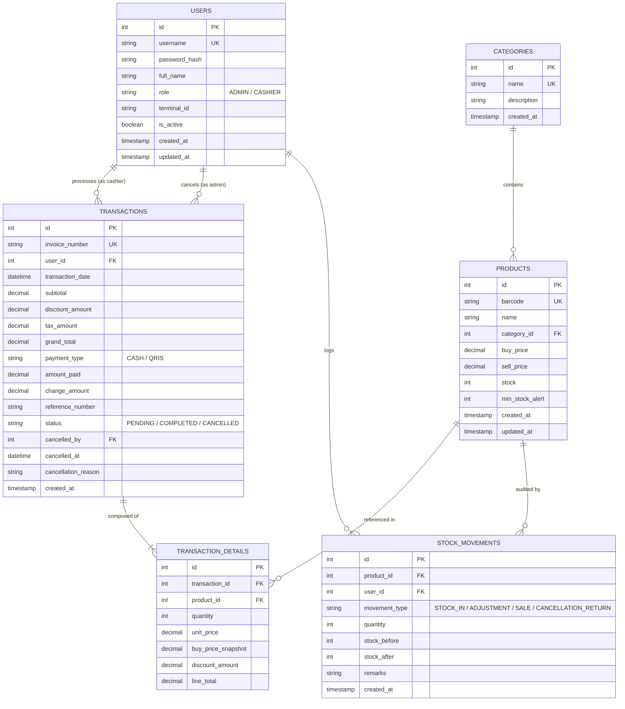

# Entity Relationship Diagram (ERD) - POS_app

Dokumen ini memetakan relasi antar-entitas data dalam basis data **pos_app_db** menggunakan diagram Mermaid ERD beserta penjelasan kardinalitas dan integritas referensial.

---

## 1. Diagram ERD (Mermaid)

---

## 2. Penjelasan Kardinalitas & Integritas Referensial

1. **`CATEGORIES` ke `PRODUCTS` (1 to Many):**
   - Satu kategori dapat memuat banyak produk ($1 : N$).
   - Aturan Hapus: `ON DELETE RESTRICT` (Kategori tidak boleh dihapus jika masih terdapat produk yang menggunakannya).

2. **`PRODUCTS` ke `TRANSACTION_DETAILS` (1 to Many):**
   - Satu produk dapat dibeli dalam banyak transaksi ($1 : N$).
   - Aturan Hapus: `ON DELETE RESTRICT` (Produk yang sudah memiliki riwayat penjualan tidak boleh dihapus demi menjaga integritas data akuntansi).

3. **`TRANSACTIONS` ke `TRANSACTION_DETAILS` (1 to Many - Komposisi Kuat):**
   - Satu header transaksi wajib memiliki 1 atau lebih rincian belanja ($1 : N$).
   - Aturan Hapus: `ON DELETE CASCADE` (Jika transaksi dibatalkan/dibersihkan secara permanen, detail item transaksi otomatis terhapus).

4. **`USERS` ke `TRANSACTIONS` (1 to Many):**
   - Satu pengguna kasir dapat melayani banyak transaksi ($1 : N$).
   - Kolom `cancelled_by` secara terpisah mereferensikan pengguna Admin yang melakukan pembatalan nota.

5. **`PRODUCTS` & `USERS` ke `STOCK_MOVEMENTS` (1 to Many):**
   - Setiap mutasi stok barang terhubung dengan produk yang bersangkutan dan staf yang bertanggung jawab.

