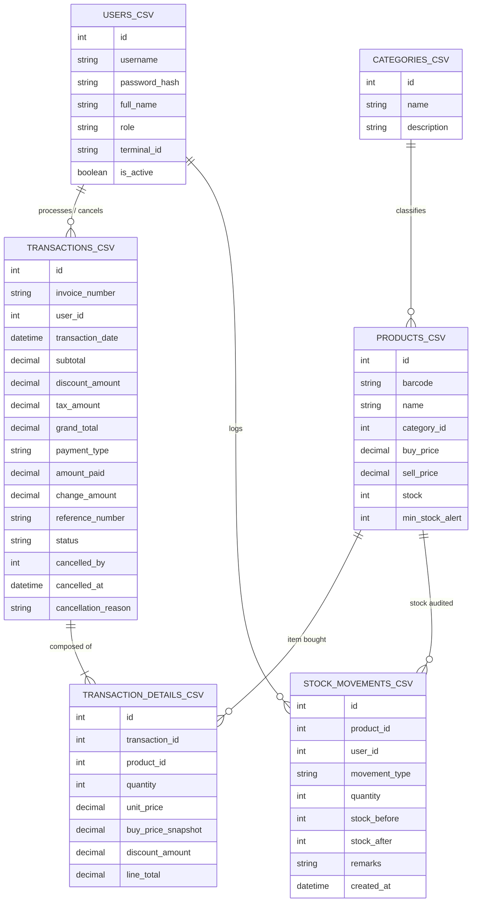

# File Data Structure & Entity Relationship - POS_app

Dokumen ini memetakan relasi logis antar-berkas data CSV pada aplikasi **POS_app**. Meskipun menggunakan berkas teks CSV tanpa engine database relasional, integritas relasi referensial ditegakkan melalui DAO dan Service Layer.

---

## 1. Diagram Relasi Berkas Data (Entity Relationship via CSV)

---

## 2. Integritas Relasi Referensial pada Lapisan Aplikasi

1. **Foreign Key Integrity:**
   - Ketika menambahkan produk baru pada `products.csv`, `ProductService` memverifikasi bahwa `category_id` benar-benar terdaftar di `categories.csv`.
   - Sebuah kategori tidak dapat dihapus jika masih ada produk yang mereferensikannya.
2. **Snapshotting:**
   - Kolom `unit_price` dan `buy_price_snapshot` pada `transaction_details.csv` menyimpan salinan permanen harga pada saat transaksi terjadi.
3. **Pemberian ID Unik (Auto-Increment Manual):**
   - DAO bertanggung jawab membaca nilai ID maksimum yang ada pada file CSV (`max(id) + 1`) sebelum menambahkan baris baru, menjamin ID tidak pernah duplikat.

