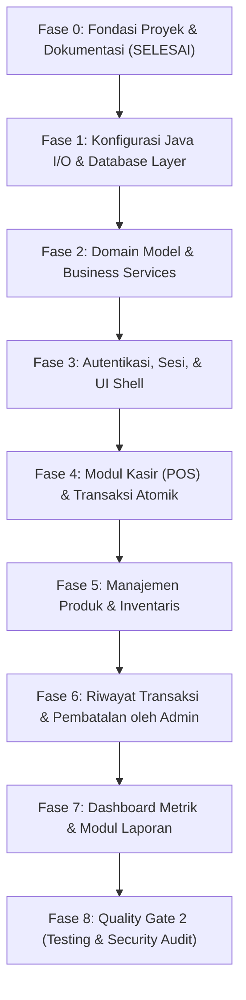

# Implementation Plan & Roadmap - POS_app

Dokumen ini mendefinisikan tahapan implementasi bertahap (*phased roadmap*) untuk pengembangan aplikasi **POS_app**. Seluruh pengembangan wajib mematuhi **Quality Gates** sebelum melangkah ke fase berikutnya.

---

## 1. Ikhtisar Tahapan Pengembangan (Phases)

---

## 2. Rincian Pekerjaan Tiap Fase

### Fase 0: Persiapan Arsitektur & Dokumentasi (Status: SELESAI / Menunggu Review)
- Penyusunan PRD, Scope, User Stories.
- Pembuatan dan persetujuan `OOP_DESIGN.md`.
- Desain skema database MySQL (`schema.sql` dan `seed.sql`).
- Penyiapan template konfigurasi Java I/O (`config/app.properties.example`).

### Fase 1: Konfigurasi Java I/O & Data Access Layer (Persistensi)
- **Implementasi Java I/O:**
  - Membuat `com.posapp.util.AppConfig` yang secara eksplisit menggunakan `java.io.File`, `java.io.FileInputStream`, `java.io.IOException`, dan `java.util.Properties`.
  - Membuat `com.posapp.util.DatabaseConnection` yang membaca URL dari `AppConfig`.
- **Implementasi DAO Interfaces & JDBC:**
  - Membuat interface `UserDao`, `CategoryDao`, `ProductDao`, `TransactionDao`, `InventoryDao`.
  - Mengimplementasikan kelas JDBC dengan `PreparedStatement` aman dan mapping `ResultSet`.

### Fase 2: Domain Model & Business Logic Services
- Mengimplementasikan kelas-kelas domain sesuai `OOP_DESIGN.md`:
  - `User`, `Admin`, `Cashier`.
  - `Product`, `Category`.
  - `Payment`, `CashPayment`, `QrisPayment`.
  - `Transaction`, `TransactionItem`.
  - `StockMovement` dan enums.
- Mengimplementasikan `AuthService`, `ProductService`, `PosService`, `InventoryService`, `TransactionService`.
- Menulis unit tests untuk kalkulasi model dan invarian domain.

### Fase 3: Autentikasi, Sesi Pengguna, & Main UI Layout
- Pembuatan `AppLauncher.java` dan `MainApp.java`.
- Pembuatan tampilan FXML dan Controller:
  - `views/login.fxml` dan `LoginController.java`.
  - `views/main_layout.fxml` dan `MainDashboardController.java` (sidebar navigasi adaptif berbasis peran Admin vs Kasir).
- Manajemen sesi pengguna via `UserSession.java`.

### Fase 4: Modul Kasir (Point of Sale) & Transaksi Atomik
- Pembuatan `views/pos.fxml` dan `PosController.java`.
- Fitur scan barcode, keranjang belanja dinamis, kalkulasi diskon, subtotal, grand total.
- Dialog pembayaran: Tunai (hitung kembalian) dan QRIS.
- Orkestrasi penyimpanan atomik JDBC (`TransactionDaoJdbc.saveWithItems`):
  - Insert `transactions`
  - Insert `transaction_details` (snapshot harga)
  - Update `products.stock`
  - Insert `stock_movements` (tipe `SALE`)
  - Commit / Rollback

### Fase 5: Modul Manajemen Produk & Persediaan (Inventory)
- Pembuatan `views/products.fxml`, `views/product_dialog.fxml`, dan `ProductController.java`.
- Pembuatan `views/inventory.fxml` dan `InventoryController.java` (Restock, Opname penyesuaian stok, audit log mutasi).
- Indikator peringatan stok menipis (*low stock alert*).

### Fase 6: Riwayat Transaksi & Fitur Pembatalan oleh Admin
- Pembuatan `views/transaction_history.fxml` dan `TransactionHistoryController.java`.
- Filter rentang tanggal dan pencarian nomor faktur.
- Pembuatan `views/cancel_dialog.fxml` dan `CancelDialogController.java`:
  - Otorisasi ketat peran Admin.
  - Alur transaksi atomik pembatalan: status transaksi `CANCELLED`, stok barang direstorasi otomatis, log mutasi `CANCELLATION_RETURN`.

### Fase 7: Dashboard Metrik & Modul Laporan
- Pembuatan `views/dashboard.fxml` dan `DashboardController.java`:
  - 4 kartu metrik (Penjualan hari ini, jumlah transaksi, total produk, stok kritis).
  - Tabel ringkas produk dengan stok menipis.
- Pembuatan `views/reports.fxml` dan `ReportController.java`:
  - Laporan penjualan harian & bulanan.
  - Laporan produk terlaris.
  - Valuasi persediaan stok.
  - Ringkasan keuntungan kotor (*Gross Profit*).

### Fase 8: Quality Gate 2 (Testing & Security Audit)
- Menjalankan seluruh test suite otomatis: `mvn test`.
- Verifikasi proteksi SQL Injection pada seluruh DAO.
- Verifikasi penanganan error saat file konfigurasi `config/app.properties` hilang.
- Verifikasi visual JavaFX tanpa error binding atau FXML missing attributes.
- Persiapan Quality Gate 3 untuk persetujuan pengguna sebelum commit/push git.

