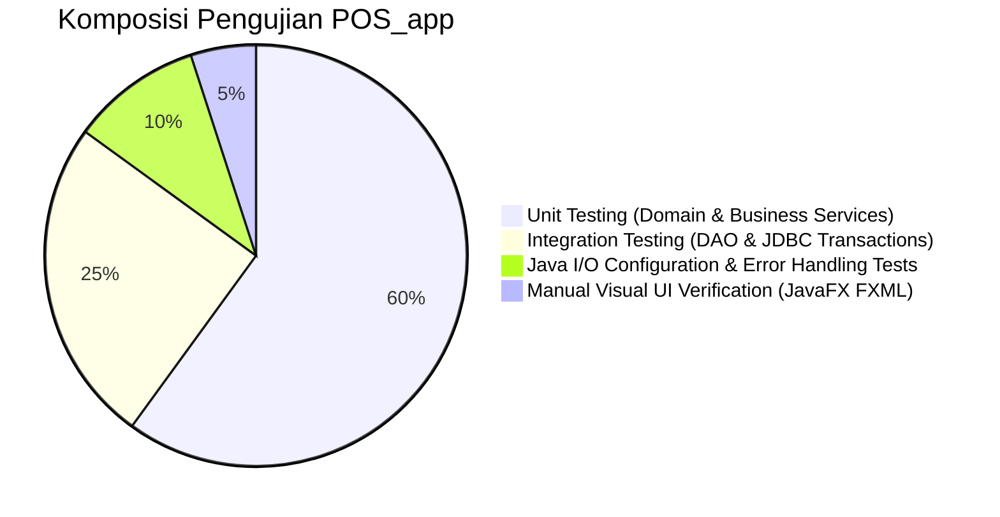

# Testing Strategy & Quality Assurance Plan - POS_app

Dokumen ini mendefinisikan strategi pengujian otomatis, cakupan pengujian, dan metodologi verifikasi kualitas (**Quality Gate 2**) untuk aplikasi **POS_app**.

---

## 1. Piramida & Cakupan Pengujian (Testing Scope)



1. **Unit Testing (JUnit 5):**
   - Menguji logika matematis dan invarian domain tanpa ketergantungan database (kalkulasi grand total, diskon, uang kembalian, mutasi stok, validasi harga).
   - Menjalankan pengujian dengan kecepatan tinggi ($< 5\text{ detik}$ untuk seluruh suite).
2. **Integration Testing (JDBC & Transaction Control):**
   - Memverifikasi eksekusi query SQL pada `PreparedStatement`.
   - Menguji mekanisme *rollback* transaksi saat terjadi kegagalan data di tengah proses checkout atau pembatalan transaksi.
3. **Java I/O Configuration Testing:**
   - Memverifikasi pembacaan file konfigurasi `config/app.properties` via `FileInputStream`.
   - Menguji penanganan kesalahan saat file konfigurasi tidak ada atau properti wajib kosong.
4. **Manual & Visual UI Testing:**
   - Memastikan hierarki tampilan FXML, binding elemen tabel, responsivitas navigasi, dan keterbacaan angka rupiah di layar kasir.

---

## 2. Struktur Paket Pengujian

```
src/test/java/com/posapp/
├── model/
│   ├── ProductTest.java              # Invarian harga & mutasi stok
│   ├── TransactionTest.java          # Komposisi item & kalkulasi total
│   ├── CashPaymentTest.java          # Hitung kembalian & validasi uang cukup
│   └── QrisPaymentTest.java          # Validasi settlement presisi nominal
├── service/
│   ├── PosServiceTest.java           # Alur keranjang & checkout
│   ├── AuthServiceTest.java          # Verifikasi password hash BCrypt
│   └── InventoryServiceTest.java     # Restock & deteksi low stock
└── util/
    ├── AppConfigTest.java            # Java I/O: File, FileInputStream, Properties
    └── CurrencyFormatterTest.java    # Pemformatan angka Rupiah
```

---

## 3. Menjalankan Pengujian Otomatis

Seluruh pengujian dijalankan melalui Maven Surefire Plugin:

```bash
# Menjalankan seluruh test suite
mvn test

# Menjalankan kelas test spesifik
mvn test -Dtest=TransactionTest

# Menghasilkan laporan test surefire
mvn surefire-report:report
```

---

## 4. Kriteria Kelulusan Quality Gate 2

Sebelum kode dianggap siap atau diajukan untuk rilis:
1. **100% Tests Pass:** Seluruh unit test JUnit 5 wajib berstatus hijau (*exit code 0*). Tidak boleh ada test yang sengaja di-`@Disabled` atau diabaikan tanpa justifikasi tertulis.
2. **Zero SQL Injection Risk:** Tidak ada query database yang menggunakan konkatenasi string.
3. **No Unhandled I/O Exceptions:** Pembacaan konfigurasi harus memiliki penanganan aman terhadap `FileNotFoundException` dan `IOException`.
4. **No JavaFX Binding Leaks:** Tidak ada unhandled exceptions pada thread JavaFX Application.

